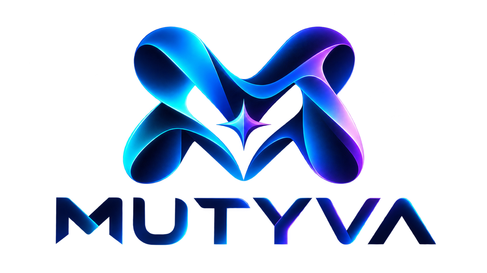

  

# MUTYVA — One App. Infinite Forms.

**🇫🇷 [Étude de cas — Architecture, IA et MVP](docs/CASE_STUDY_FR.md)** — Présentation technique du runtime déclaratif et des mutations contrôlées.

**Одно приложение. Любая форма.** Локальная среда приложений на Qt с общей палитрой, предпросмотром изменений и историей поколений.

**Status:** declarative Qt editor with validated local mutations and preview, 2026-10-18. **Language:** Russian.
**Product:** One AI-driven Qt application that can become many applications; after a mutation is saved, it executes independently of AI.

## Product in one sentence

MUTYVA is a local, declarative, cross-platform application runtime with a component palette, immutable mutation history and an AI designer authorized via **Sign in with ChatGPT**.

**Русская краткая инструкция:** [START_HERE_RU.md](START_HERE_RU.md). Подробные инженерные спецификации ниже даны на английском для удобства программирующих агентов.

## What this package contains

| Path | Why open it |
|---|---|
| `docs/00_PRODUCT_VISION.md` | Unambiguous product vision and what NOT to build |
| `docs/01_MVP_SPEC.md` | User journeys, screens and definition of done |
| `docs/02_ARCHITECTURE.md` | Qt/C++ modules, boundaries, storage, event flow |
| `docs/03_CHATGPT_AUTH.md` | Verified Sign in with ChatGPT integration blueprint |
| `docs/04_DECLARATIVE_RUNTIME.md` | Declarative schema, controlled mutations and history |
| `docs/05_DEMO_CITY_PULSE.md` | Public APIs, response mapping and demo narrative |
| `docs/06_IMPLEMENTATION_ROADMAP.md` | Thin vertical slices, tasks and milestones |
| `docs/07_TESTING_SECURITY.md` | End-to-end acceptance, threats, offline and error tests |
| `docs/08_PLATFORMS_RELEASE.md` | Windows, Android, macOS, Linux and iOS strategy |
| `docs/09_ENGINEERING_DECISIONS.md` | Binding decisions and non-goals |
| `docs/10_AGENT_HANDOFF.md` | Copyable implementation instructions for coding agents |
| `specs/` | JSON schemas (application and mutation) |
| `examples/` | Declarative City Pulse and an example mutation |
| `starter/` + root `CMakeLists.txt` | Qt 6 editor with live APIs, schema-checked documents, four mutation operations and preview |
| `tests/RuntimeTest.cpp` | Qt tests for validation, mutation atomicity, preview/cancel, restart and QML rendering |
| `runtime/` + `docs/11_AI_DESIGN_CONTRACT.md` | Installed palette, designer rules, inspectable context and response contract (local only) |
| `docs/12_GENERAL_PALETTE.md` + `examples/general-workspace.mutyva.json` | Seven general components, nested v2 layouts and an interactive Notes example |
| `docs/14_CHAT_FIRST_UX.md` + `docs/15_AI_CONNECTION.md` | Primary chat UX, Windows AI integration and honest verification limits |
| `docs/13_LOCAL_DATA.md` | Persistent app-scoped SQLite data, transactional input/list actions and conflict recovery |
| `branding/` + `android/` | Source artwork, shared palette, desktop/Android icons and welcome/about identity |
| `tools/validate_examples.py` | Standard-library example checks |

## Default weather city

Ask **«Показывай по умолчанию погоду в Poitiers»** in chat and apply the preview. The saved city loads on restart. Manual city searches remain temporary. See [docs/17_DEFAULT_CITY.md](docs/17_DEFAULT_CITY.md).

## Main interface

The main screen exposes **Чат с AI** and the running application. Open the chat, choose **Continue with ChatGPT**, finish browser sign-in and send a request. The host prepares context internally and shows a preview for confirmation. The first Windows OAuth/Responses integration is implemented; a real-account Windows live suite passed on 2026-10-19 (reply plus isolated AI mutation/apply/restart). Tokens and chat are memory-only for now; restart requires sign-in again. Technical editors, context inspection and demo actions are available only in developer mode (**Ctrl+Shift+D**); the instructions below use that mode.

## Quickest path to a visible result

1. Install **Qt 6.8+** with Qt Quick, Qt Quick Controls, Qt SQL with QSQLITE and the desktop kit, CMake and C++20 toolchain.
2. Open the root `CMakeLists.txt` in Qt Creator, or use `qt-cmake -S . -B build` then `cmake --build build --config Release`.
3. Run `mutyva-demo` with internet access. Use **Ctrl+Shift+D** to reveal the development tools described below. It searches **Paris** and displays weather, a seven-day forecast and air quality via Open-Meteo.
4. Press **+ Виджет влажности**: review the candidate interface, then press **Применить** to save a new generation or **Отмена** to discard it.
5. Use **Изменить интерфейс** to add/remove/reorder components or edit their titles. **Редактор JSON** accepts a full declaration or a mutation; validation failures preserve the running document and HEAD.
6. Restart: the saved interface remains changed, without an AI request. **Предыдущее сохранение** previews the immediately preceding numeric snapshot; **Сбросить интерфейс** previews the bundled baseline. Both require Apply. A full history browser is the next slice.
7. Return to normal mode with **Ctrl+Shift+D**, open **Чат с AI** and sign in. The first Windows integration connects messages to validation/preview/commit; verify with your eligible account. See `docs/15_AI_CONNECTION.md`.

**Important:** this is not the finished MVP. The chat and developer editor share the checked mutation path. Protected persistent sessions, refresh, multi-account selection, generic SQL connectors, production auth/security review and iOS verification remain work items. Weather bindings are fixed; general controls use typed actions and persist input/list data separately in SQLite. The schema checker supports the bundled schemas, not arbitrary JSON Schema documents. Preview reloads widget instances; generic values are kept by stable ID/kind, while weather search view state is not reconciled yet.

## Build and tests

**Real ChatGPT test:** run `powershell -ExecutionPolicy Bypass -File tools/run_live_ai_test.ps1`, complete browser sign-in once, and let the test send requests and verify replies, a humidity card, the default weather city, isolated commits and restart automatically. Results: `build-msvc/live-ai-report.json`. See [docs/16_LIVE_AI_TESTS.md](docs/16_LIVE_AI_TESTS.md). This is opt-in and uses account plan limits; normal CTest remains offline.

**Branding:** supplied artwork is integrated into README, application resources, first-run welcome/About and desktop/Android packaging. See [branding/README.md](branding/README.md) for exports, reproduction and platform verification notes. Runtime display branding preserves the previous data-storage namespace.

**Designer context:** open **Изменить интерфейс → Замысел и контекст AI**, enter a request and prepare/view the local packet. It includes product concept, the installed catalog, current saved declaration and schemas. To exercise response handling without a model, paste `examples/designer/add-humidity-response.json` in **Редактор JSON → Ответ AI** after preparing context. Proposal, clarification and unsupported responses are checked separately. This developer-only preparation does not send inference; the normal chat sends only after verified sign-in and explicit Send. See `docs/11_AI_DESIGN_CONTRACT.md` for the conceptual model and path toward a general component palette.

**General palette:** press **Пример: заметки**, review and Apply. Text, Card, Stack, Row, Input, Button and List work without AI. Notes and input drafts persist in a separate SQLite database across restarts. Interface rollback does not roll back these data. **Перечитать данные** recovers from a stale-window conflict after showing an error. Qt SQL / QSQLITE is required. See `docs/12_GENERAL_PALETTE.md` and `docs/13_LOCAL_DATA.md`.

Enable tests with `-DBUILD_TESTING=ON` (requires the Qt Test module), build, then run `ctest --test-dir build -C Release --output-on-failure`. Tests use temporary stores and offline QML rendering; they do not modify the user's saved generations or contact weather APIs. Use `-DBUILD_TESTING=OFF` for an application-only build.

Windows MSVC example: `cmake -S . -B build-msvc -G "Visual Studio 17 2022" -A x64 -DCMAKE_PREFIX_PATH=C:/Qt/6.12.0/msvc2022_64`, then `cmake --build build-msvc --config Release`. Run `windeployqt --release --qmldir starter/qml build-msvc/Release/mutyva-demo.exe` from the matching Qt kit before launching the EXE outside Qt Creator.

## MVP demo sequence

**Real public APIs → user asks for a change → ChatGPT returns declarative mutation → validate and preview → apply atomically → save generation → restart and work without ChatGPT.**

## No unnecessary infrastructure

No MUTYVA server, package registry, accounts, marketplace, backend, synced state, Ollama, alternate models, Flutter, Avalonia, custom kernel or Assembly. A user's optional **ChatGPT authorization** is not a MUTYVA account.

## Key technical choices

- **Qt 6.8+**, **C++20**, **QML/Qt Quick**, **CMake**.
- Local **SQLite** for catalog, history, settings and cached data in full MVP; the current runtime uses JSON snapshots for interface history and a separate SQLite database for input/list user data.
- Declarative and schema-validated application trees; QML renders **prebuilt registered components**. Do not load untrusted generated QML as code.
- OpenAI **Sign in with ChatGPT** for eligible open-source local applications, OAuth2 Authorization Code + PKCE + OIDC; no unofficial ChatGPT web endpoints or stolen sessions.
- Open-Meteo for a noncommercial demo; licensing/attribution requirements apply.

## Authoritative links (review again before implementation)

- Sign in with ChatGPT overview: https://developers.openai.com/siwc/token-sharing-open-source
- Sign-in and registration: https://developers.openai.com/siwc/token-sharing-open-source/sign-in
- Models and inference: https://developers.openai.com/siwc/token-sharing-open-source/models-and-inference
- Preview limitations: https://developers.openai.com/siwc/token-sharing-open-source/preview-limitations
- Qt Network Authorization: https://doc.qt.io/qt-6/qoauth2authorizationcodeflow.html
- Qt supported platforms: https://doc.qt.io/qt-6/supported-platforms.html
- Open-Meteo: https://open-meteo.com/en/docs and https://open-meteo.com/en/terms

## Documentation discipline

These documents describe **the proposed MVP target**, not released capabilities. Update docs as code evolves; avoid a changelog of speculative versions. Do not proclaim a feature done until the acceptance tests in `docs/07_TESTING_SECURITY.md` pass.
