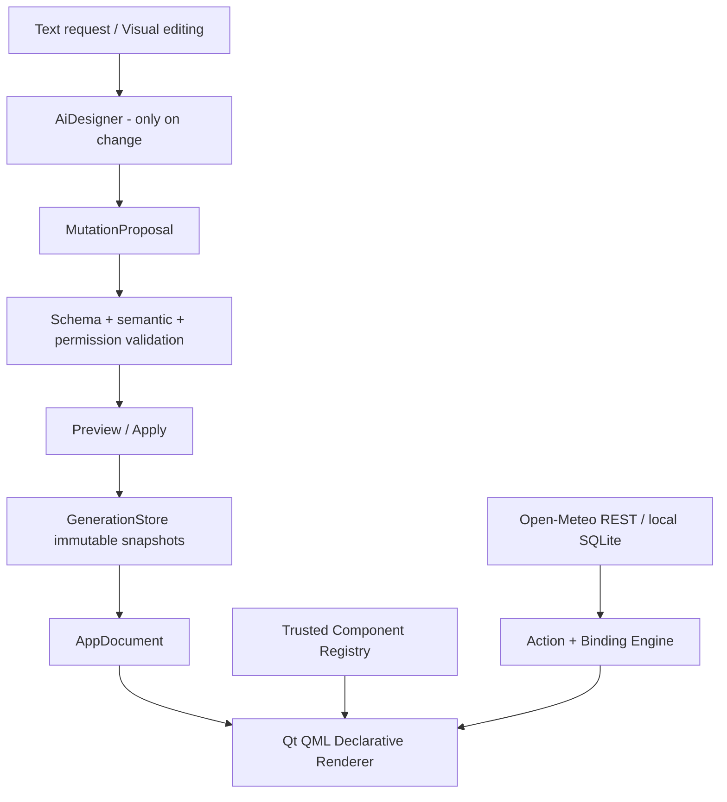

# Qt/C++ Architecture

## Runtime layers



## Target modules, concrete responsibilities

| Module | Stack | Contract |
|---|---|---|
| `MutyvaShell` | QML Quick Controls | Responsive shell, chat/design sheet, previews, generation browser |
| `AppDocument` | C++/JSON | Canonical validated description, stable IDs, immutable structures |
| `ComponentRegistry` | C++ types and QML components | Look up `kind`, property schema, capabilities, target compatibility |
| `UiRenderer` | QML Loader + prebuilt types | Renders known components only, no string-to-QML eval |
| `WeatherConnector` | Qt Network | Public HTTPS API calls, parse/normalize, retries and errors |
| `DataStore` | Qt SQL + SQLite | Local bookmarks/cache/document catalog in future MVP slices |
| `BindingEngine` | C++ | Read-only selectors and typed state subscriptions, no eval |
| `ActionEngine` | C++ | Allowlisted actions: refresh, search, select, set local value |
| `MutationEngine` | C++ | Validate, construct candidate, preview, commit or discard |
| `GenerationStore` | SQLite+filesystem | Immutable snapshots, atomic HEAD, restore as new generation |
| `ChatGPTAuth` | Qt NetworkAuth + OIDC validator | SIWC PKCE, host/client IDs, token exchange, refresh and secure storage |
| `AiDesigner` | Qt Network / SSE | Account-specific model choice, streaming Responses, typed mutation proposal |

## Important dependency boundaries

- `UiRenderer` **must not know about** OAuth or OpenAI. It only sees a validated `AppDocument`.
- AI output **must not call arbitrary native functions**. It can request only enumerated mutation operations.
- `ComponentRegistry` enumerates known kinds and property schemas, so unsupported kinds fail before rendering.
- `DataConnectors` own all I/O. QML never sees access tokens and never concatenates untrusted SQL.
- `GenerationStore` persists definitions and references; external business data is independent and is not snapshotted by GUI rollback.
- Account sign-in is optional for normal execution. This is not a local MUTYVA login.

## Source layout for intended full MVP

```text
src/
  app/ AppDocument, GenerationStore, MutationEngine
  components/ ComponentRegistry, PropertySchema
  data/ WeatherConnector, RestConnector, LocalStore
  ai/ ChatGPTAuth, OidcVerifier, AiDesigner, SseDecoder
  security/ PermissionGate, ProtectedCredentialStore
qml/
  shell/ Landing, Workspace, DesignSheet, MutationPreview, History
  components/ CitySearch, WeatherSummary, ForecastList, AirQuality, Humidity
schemas/
  app.schema.json, mutation.schema.json
examples/
  city-pulse.mutyva.json
```

## Data flow (live weather)

User city -> geocoding GET -> coordinates -> parallel forecast GET + air-quality GET -> normalized typed CityWeather state -> Q_PROPERTY signals -> QML components. Search and display do **not** invoke ChatGPT.

## Data flow (AI mutation)

Prompt + approved app context + available kinds -> authenticated `POST /v1/responses` with streaming -> parse final assistant proposal -> JSON Schema validation -> semantic validation -> preview -> Apply -> atomic snapshot generation -> renderer incremental change.

## Local state, persistence and portability

Full MVP uses SQLite catalog with `apps`, `generations`, `component_installations`, `local_settings`, `api_cache` tables plus immutable JSON blobs stored locally. Use content hash as an integrity check (not security signing). Keep all credentials in OS secure storage, separately from exportable app packages. Use `QStandardPaths::AppDataLocation`; do not hardcode `%APPDATA%` or `$HOME`.

## Cross-platform nuance

`QOAuth2AuthorizationCodeFlow` helps with PKCE, but a production OIDC verifier must validate tokens and a protected credential store must be implemented; “Qt has OAuth” is not equal to “we have secure ChatGPT auth”. Native loopback callback on `127.0.0.1` must be proven on each mobile OS. See `03_CHATGPT_AUTH.md` and `08_PLATFORMS_RELEASE.md`.

## First integrated vertical slice

The starter chooses the lightest functional subset: live public API calls, QML, local JSON declaration and immutable generations. Do not multiply abstractions until the real AI vertical slice is proven.
