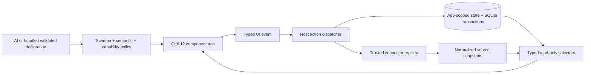

# Composition Contract — typed state, interactions and responsive layout

**Design target, 2026-10-23. Not implemented merely because it is documented.** See [current palette](19_COMPONENT_REFERENCE.md), [external data](21_CONNECTOR_CONTRACT.md), [AI design workflow](22_AI_DESIGN_PLAYBOOK.md) and the [roadmap](06_IMPLEMENTATION_ROADMAP.md).

## Product rule

AI should be able to **compose useful applications from trusted Qt 6.12 components** without inventing executable code. Describe **what users see, where data comes from, how an event changes state, and what must be persisted** in a compact, validated application definition. The host handles state, I/O, policy, rendering, history and recovery. A saved app works offline without AI (remote sources may become stale).

**Existing today:** 21 compiled `kind` values; globally stable widget IDs; flat `widgets` with `parent`; `card/stack/row/tabs`; limited `style.tone/padding`; SQLite widget values/lists; typed local record models, `record-form`/`record-list` CRUD, `filter/sort`; two generic button actions (`append-item/clear-list`); fixed Open-Meteo bindings; a single current app. The current `schemaVersion:2` does **not** support arbitrary declarative wires between widgets, computed fields, generic action routing, arbitrary REST providers, new responsive breakpoints, or remote record CRUD. This document is a **proposed future contract**, not valid JSON for the current v2 validator.

## Conceptual runtime: five distinct layers



**Boundary:** only the **host** can mutate state, invoke connectors and emit results. QML components express typed input/output ports; they do not call each other directly, interpolate arbitrary expressions, execute generated QML/JS, or access SQL/network/secrets. AI configures allowlisted contracts and never gains permissions from a prompt. Qt Quick's own JavaScript in *compiled trusted components* is implementation code, never model-produced code.

## 1. Semantic inventory: how AI thinks about an app

| Contract | Required meaning | Example |
|---|---|---|
| `Component kind` | Trusted visual affordance and allowed props/ports/events | `record-list` displays model `tasks` |
| `Data model` | Stable app-scoped IDs, typed fields, defaults and schema evolution | `tasks.title:text`, `done:boolean` |
| `State` | Widget draft, transient selection, persisted record or connector snapshot | `tasks.selectedId` |
| `Binding` | One-way typed read from an allowlisted selector to a target port | selected task title → detail label |
| `Action` | Host-owned typed command with validated sources and side effects | save form → `records.create` |
| `Event` | A trusted component event, not executable callback text | `record-list.recordSelected` |
| `Layout` | Container hierarchy and bounded responsive constraints | row with two cards; stack on mobile |
| `Connector` | Preinstalled adapter, user-approved access, normalized typed snapshots | `open-meteo.current` |
| `Generation` | Immutable saved *definition* only; restores never roll back user records | confirmed preview→Apply |

AI should construct a **small coherent graph**, not maximize component count. Distinguish immutable *configuration*, mutable *user data*, transient UI state, and cached *external data*. Every declared ID and reference must resolve within the same app; no cross-app dataflow in Useful-app MVP.

## 2. Planned ports and one-way data bindings (future v3)

For a bounded v3 proposal, provide a list of declarative edges with no expressions or string interpolation:

```json
{
  "bindings": [
    {
      "source": {"scope": "recordSelection", "model": "tasks", "field": "title"},
      "target": {"widget": "selectedTaskTitle", "port": "text"},
      "empty": {"policy": "placeholder", "text": "Выберите задачу"}
    }
  ]
}
```

This example is **illustrative future syntax, invalid in current v2**. The host must check: source exists; selector is app-scoped and read-only; output type is compatible with the target port; a missing selection becomes explicit empty/loading/error state; no implicit coercion, evaluation, or exposure of credentials; no cycles; fan-out, depth and subscription counts are bounded. The host owns subscription lifetime and atomic recomputation after commits. `recordSelection` is a local state selector, not a persisted relation.

**Minimal typed value domain:** `string`, `integer`, `number`, `boolean`, `date (ISO 8601)`, `record` and `list<T>`, each with explicit `null/empty/loading/error/stale` semantics. Numeric units and date/timezones are metadata, not inferred from labels. Permit only explicit **host-coded**, versioned conversions (e.g. integer to formatted display text); refuse arbitrary expressions, JS templates and user-supplied function names.

**Reactive flow:** host state revision changes → selector invalidation → snapshot resolution → one-way UI update; user typing into a form does not mutate a saved record until an explicit validated action succeeds. An AI mutation cannot read or overwrite the current private values in order to "preserve" them; it preserves stable IDs and records indirectly through migration rules.

## 3. Planned event/action protocol (future v3)

```json
{
  "on": {"widget": "saveTask", "event": "clicked"},
  "do": {
    "action": "records.create",
    "model": "tasks",
    "fields": {"title": {"from": {"widget": "taskTitle", "port": "value"}}}
  },
  "onSuccess": {"action": "ui.clearDraft", "widget": "taskTitle"}
}
```

Illustrative **future syntax**, not accepted by the current validator. Each registered event has a known payload type; each action declares its input schema, output/result type, permission, transaction boundary and allowed sinks. Only the host can route a click to a trusted action; no arbitrary action names, native method paths, callbacks or chains of unlimited effects. A record edit/delete must use stable record ID and revision checks, with explicit confirmation for destructive actions.

**State transitions are explicit:** `idle → pending → success | error`. Pending operations are cancellable only if the connector supports cancellation; duplicate clicks are coalesced/disabled; stale async completions cannot overwrite newer state; success does not fire before SQLite commit / validated response. On validation/permission failure the host returns a typed error and leaves state unchanged. Prevent update cycles (including event feedback loops) via static graph validation and bounded execution.

Start with **one event → one host action**, plus bounded declared success/failure UI feedback; do not implement a general workflow engine. Only add multi-step transactions when a tested user scenario requires them.

## 4. Responsive visual layout

**Current v2:** `parent` references containers, visual order is widget-array order, `row` wraps/turns vertical on narrow widths; `tabs` uses direct children. `style` currently supports at most `tone` and `padding`; `width`, `grid`, arbitrary breakpoints and design tokens are **not supported**.

**Target v3:** a minimal `layout` object on trusted containers and children with tokens rather than arbitrary QML anchors:

```json
{
  "id": "overview",
  "kind": "row",
  "layout": {
    "gap": "m",
    "align": "stretch",
    "columns": {"compact": 1, "wide": 2}
  }
}
```

Illustrative **future syntax**, not accepted in current v2. The host maps stable breakpoints (`compact`, `wide`) to Qt layout behavior; containers own alignment, spacing, width constraints and accessible scrolling. Prefer content-first stack on narrow devices; no fixed absolute placement, negative sizes, CSS, pixel-perfect AI measurements or custom QML. Common visual tokens: `space: xs/s/m/l`, `role: primary/secondary/danger`, `emphasis: normal/strong`; theme remains Qt/native-host owned.

**Layout invariants:** component tree must remain acyclic and depth-limited; all focusable controls reachable at ~360dp, readable at desktop; keyboard focus, touch targets, accessible names, visual overflow, localization and scalable fonts are tested. Tabs must not accidentally hide user data or create/remove records. Preview shows compact and wide samples without executing actions.

## 5. Safe evolution and preview

Mutations must preserve app/model/widget stable IDs; new optional fields or required fields with validated defaults are additive. Existing field removal/type change is rejected until a separately verified migration path is available. **Definition generation** is separate from user data, connector caches and transient selection. Preview is side-effect free; host shows:
- UI changes (add/remove/reorder, container moves, visual tokens and compact/wide impact)
- Data model changes (fields, defaults, migration implications, existing rows preserved)
- Action changes (event → command, selected inputs, mutating side effects)
- Connector changes (provider, domains/scopes, privacy and offline behavior; new grants require approval)
- Unsupported requests: exact missing registered capability and safe fallback

The preview must be validated against the *same registry version* that will execute it. Apply is atomic for definition, and commits user-data changes only in explicitly reviewed migrations. Restoring UI does not undo CRUD operations.

## Incremental delivery: do not design a platform before one working scenario

1. **C1 — model/selection → text:** host-owned read-only selection selector and view port; tests prove update, clear, missing record and isolation.
2. **C2 — event → typed command:** one explicit host action with result/error and one local form/list scenario; reject fabricated events or actions.
3. **C3 — responsive containers:** two layout tokens and compact/wide reflow; screenshot/focus tests.
4. **C4 — source snapshot → view:** reuse existing Open-Meteo as the first typed connector port; simulate offline/stale/malformed cases. Introduce a second **curated read-only** external source only after security review.
5. **C5 — AI end-to-end:** natural request constructs a valid useful app, then safely changes it; offline saved state and data survive. This depends on R2/R3 independent app creation.

All target changes require an opt-in versioned schema (R1-01), migration/test fixtures and actual Qt 6.12 build; **do not add future fields to current v2 JSON** merely to make a demo look complete.
