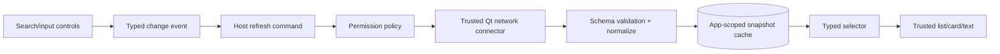

# External Data Connector Contract — read-only first

**Architecture target (not a currently supported generic REST connector), 2026-10-23.** Related: [composition and bindings](20_COMPOSITION_CONTRACT.md), [security test gates](07_TESTING_SECURITY.md) and [current City Pulse/Open-Meteo adapter](05_DEMO_CITY_PULSE.md).

## Current verified scope versus desired scope

**Current implementation:** only `open-meteo` is an accepted `dataSources[*].provider`, and `source.kind` is `rest`; city, forecast and air widgets map its data through compiled C++ `WeatherService`. The source permissions are fixed by the catalog. There is no arbitrary user URL, generic field selector, auth header, JSONPath, OpenAPI importer, user-written JavaScript, mutation-generated REST client, or remote CRUD. Requests made by the app are independent of AI and user data stays local.

**Goal:** expose externally fetched **typed read-only datasets** as ordinary read-only selectors for any trusted view component. The same UI/data binding contract should work for local models and connector snapshots, without letting an AI prompt specify network traffic or exfiltrate records.

## Five layers and their responsibilities

1. **Installed connector registry** (bundled/trusted): immutable `providerId`, connector version, approved hosts and URL templates, methods, inputs, typed output, capabilities, licensing/attribution, refresh policy, maximum result size and diagnostics. A JSON declaration can refer to an installed provider, not install one.
2. **App connection instance**: `sourceId`, `providerId`, approved public parameters and names of datasets exposed. No untrusted arbitrary host/path or headers.
3. **Permission gate**: explicit user consent for new domain/scope, separate from approving layout changes. Revocation stops requests; AI cannot silently grant or widen domains. Credentials, where eventually needed, are held by OS-secure storage, never by declaration or prompt.
4. **Connector worker**: trusted Qt Network C++ code resolves allowed endpoint and performs bounded asynchronous HTTPS reads, typed decoding/normalization, cancellation and policy. No HTTP access from generic QML.
5. **Snapshot**: `{data, status, timestampUtc, sourceId, sourceRevision, stale, provenance}`. Bindings subscribe to snapshots and render loading/empty/error/stale states, not guessed zeroes.

## Proposed descriptor (future, not accepted by current app.schema.json)

```json
{
  "sourceId": "cityWeather",
  "providerId": "open-meteo",
  "providerVersion": 1,
  "parameters": {"city": {"scope": "state", "id": "selectedCity"}},
  "output": "weather.current",
  "refresh": {"mode": "manual-or-on-change", "minIntervalSeconds": 60}
}
```

The descriptor is **illustrative target syntax** only. `providerId` resolves to a trusted connector compiled or bundled with the host. Parameter references are strictly typed and non-secret; no general string concatenation or expression language. A connector can output multiple normalized read-only datasets with distinct port names. Any new external provider requires an explicit trusted adapter/manifest plus security and acceptance tests, **not only a catalog JSON entry**.

## Trust boundaries and attack cases

- **No SSRF:** never accept unapproved arbitrary URLs/domains/ports/protocols; enforce HTTPS, host/port and path allowlists, recheck redirects, reject localhost, link-local/private/metadata IPs and DNS rebinding; disallow arbitrary proxy targets.
- **No secret leakage:** do not serialize credentials, headers or personal rows into app definitions, generation history, errors or AI context; never reuse ChatGPT OAuth credentials for third-party APIs.
- **No implicit data exfiltration:** local record values must not become connector parameters unless a specific vetted outbound-data permission and explicit user action allow it (outside first read-only release).
- **Bounded resources:** response size, redirect count, network timeout, connection concurrency, retries/backoff, per-source query limits, cache TTL and disk use are capped by host policy. HTTP 401/403/429/500, offline, malformed or oversize payloads are distinguishable and testable.
- **Typed decoding:** fixed shape, numeric ranges/units, timestamp and locale expectations; unknown fields ignored or rejected by policy; never parse a source response as commands, prompts or Qt instructions.
- **Race safety:** each request carries an input revision; late or cancelled responses cannot replace a newer city/query's snapshot.
- **Consent semantics:** preview explains provider/host, public/private data leaving the device, network requirements and whether data is cached; refusing permission leaves saved app usable with an explicit unavailable state.
- **Persistence:** connector cache is app-scoped, timestamped and purgeable, **not part of UI generation rollback**; cached stale data is clearly labeled and never presented as live.

## Source-to-component interactions



Keep a connector's error state visible as data. The same dataset may feed several components without re-fetching for each widget; the host deduplicates and caches it. **No cross-app data binding** before the multi-app isolation gate R2. AI receives only the metadata schema and granted capability names; it never receives live remote payloads by default.

## MVP scenario and order

**First proof:** make the *existing Open-Meteo normalized snapshot* accessible to a generic `text`/read-only view port by a validated descriptor. Verify selected city → refresh → multiple views, stale city race, offline and error states. No new external provider and no generic HTTP client in this step.

**Second proof:** introduce one vetted public *read-only* JSON provider and one typed list display. Validate external host, data model, permissions, attribution, pagination cap, malformed payload and offline cache. No custom endpoint editor until this is proven.

**Later, not in R1:** authenticated API providers, writing remote records, user database connectors, OAuth per provider, credentials lifecycle and arbitrary schemas. Each needs a separate permission/threat/migration plan.

### Acceptance gates

- Registry-derived schema and ports verified against the bundled connector adapter, and portable across Qt 6.12 Windows/Android where built.
- HTTP fixture tests for success, error, timeout, size, wrong type, missing mandatory field, redirects/DNS rebinding rejection, stale response and revocation; no network in normal CTest.
- Two generic visual consumers of the **same** snapshot receive consistent revision and status; rapid user changes cannot display obsolete response.
- No connector request is made in mutation preview. Snapshot failure does not damage local CRUD data or UI history.
- Report explicit **unsupported** to AI for providers/remote writes not installed or permitted.
