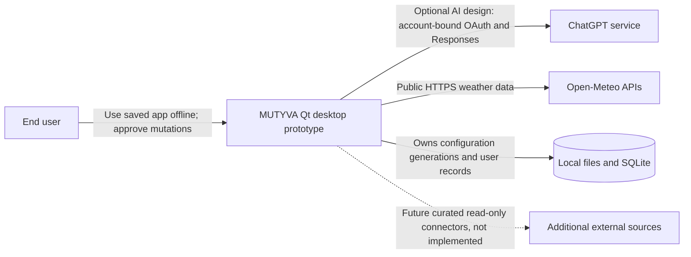
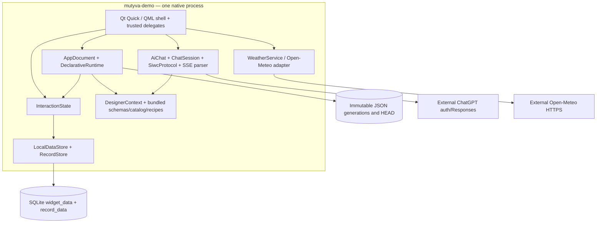

# MUTYVA — Architecture Baseline & Assessment

**Review date:** 2026-10-23 · **Source baseline:** `c871c0ece3340b50de7120f1e065b192025b713f` · **Review type:** static source + documentation + published CI evidence; no live Qt 6.12 runtime build was executed in this assessment.

**Read this first** with [architecture workflow](24_ARCHITECTURE_WORKFLOW.md), [architecture decisions](adr/README.md), [authoritative roadmap](06_IMPLEMENTATION_ROADMAP.md) and [current component reference](19_COMPONENT_REFERENCE.md). This is a decision and evidence document, **not** a claim that all target modules exist.

## 1. Problem, stakeholders, constraints

**Problem statement:** A user should ask an AI to create or adapt a useful local native application without executing generated code, requiring a permanently connected model, or sacrificing stored records or permissions. The first end-to-end target is a Task Manager created and evolved by chat while City Pulse remains available.

**Stakeholders:** end user (utility and understandable consent); maintainer/architect (bounded growth and compatibility); security reviewer (trust boundaries and destructive actions); CI/release maintainer (reproducible builds); portfolio reviewer/client (traceable decisions and evidence). The project is personal open source; **no client or third-party delivery is implied**.

**Binding constraints:** C++20 + **Qt 6.12.x** native QML; offline execution of saved apps; no MUTYVA backend/accounts/marketplace/sync; ChatGPT is optional for *design* only; no AI-generated QML/C++/JavaScript/SQL or shell execution; no arbitrary executable extensions; new permissions require explicit approval; independent local apps and Android are not implemented yet.

**Architectural style chosen:** a **modular monolith in one client process** with restricted declarative definitions, compiled trusted components, local storage, and narrow external adapters. This is intentionally simpler than microservices or a plugin runtime: the current constraints do not justify distribution, deployment orchestration or networked components.

## 2. Context view — C4 Level 1 (observed and target edges marked)

MUTYVA has **no application backend**. The ChatGPT account is external; its sign-in is not a MUTYVA server or mandatory local runtime identity. Current desktop evidence is historical Qt 6.8; **Qt 6.12 CI is blocked on GitHub `QT_EMAIL`/`QT_PW` secrets** before compilation.

## 3. Container view — C4 Level 2, actual executable and trust boundaries

Source-grounded components: [`main.cpp`](../starter/src/main.cpp) wires Qt context properties; [`AppDocument.cpp`](../starter/src/AppDocument.cpp) validates/stages/commits/loads; [`DeclarativeRuntime.cpp`](../starter/src/DeclarativeRuntime.cpp) checks and applies declarative operations; [`InteractionState.cpp`](../starter/src/InteractionState.cpp) implements widget actions and record presentation; [`RecordStore.cpp`](../starter/src/RecordStore.cpp) owns SQL; [`DesignerContext.cpp`](../starter/src/DesignerContext.cpp) builds the bounded AI packet; [`WeatherService.cpp`](../starter/src/WeatherService.cpp) is an independent compiled network adapter.

**Architecture vs implementation:** `ComponentRegistry`, `BindingEngine`, `ActionEngine` and `MutationEngine` in [02_ARCHITECTURE.md](02_ARCHITECTURE.md) are **logical responsibilities, not separate implemented C++ classes**. Do not claim an independently implemented universal event/binding engine. Current app instances are limited to the existing City Pulse ID; v2 typed task records are demonstrated within that app.

## 4. Domain boundaries and ownership (what must not get mixed)

| Boundary | Owns | Must not own / cross |
|---|---|---|
| **Definition / generations** — `AppDocument` | validated app definition, preview candidate, immutable generation ancestry | mutable task rows, live weather response, OAuth tokens |
| **Contract validation** — `DeclarativeRuntime` | schemas, registered kinds, IDs, permission/reference checks | querying SQLite or opening URLs |
| **UI / view state** — compiled QML | rendering and local user input events | user-provided SQL or model-produced QML |
| **App interaction** — currently `InteractionState` | local widget state, record selection, dispatch to record store | direct network adapter access, acquiring new privileges |
| **Local persistence** — `LocalDataStore`, `RecordStore` | app-scoped data, transactions, stale-writer checks | changing definition generation on CRUD |
| **AI boundary** — `DesignerContext`, `AiChat` | bounded capability context and untrusted proposal transport | live private rows/credentials and automatic Apply |
| **External data** — `WeatherService` | bounded trusted weather fetch/normalization (hardening incomplete) | arbitrary model-provided URLs and direct DB writes |

**Four distinct data lifecycles:** (1) *definition* persisted as immutable JSON generations; (2) *user records and form values* persisted in SQLite, unaffected by interface rollback; (3) *transient selection, drafts and errors* in RAM; (4) *external observations* from Open-Meteo, with stale/error semantics still being improved. Never alias their versions, transactions, access rights or reset behavior.

**Important compatibility rule:** current app definition is `schemaVersion:2`, even though the catalog JSON has `version:3` as an independent registry version; no schema v3 deployment is proven. New generic dataflow/layout/connector syntax in docs 20/21 is explicitly a future proposal.

## 5. Architecture-significant requirements (ASR) and evidence

| ID | Requirement / measurable condition | Current observation | Acceptance evidence and next gate |
|---|---|---|---|
| **ASR-01 Integrity** | Interrupted update never silently replaces a confirmed definition; rollback resolves verified parent | Snapshot → metadata → HEAD, QSaveFile, SHA256 and parent ID implemented | Historical Windows Qt 6.8 CI passed; verify missing/corrupt HEAD, orphans, recovery selection and Qt 6.12: **R0-02** |
| **ASR-02 Privacy** | Private records and tokens do not enter ordinary AI context or saved definition | DesignerContext sends app metadata/catalog/schemas/recipes, not stored rows | Negative tests on all prompt/error/export paths; protected credentials and revocation still need separate gate |
| **ASR-03 Trust isolation** | Only registered kinds/actions/sources; no AI-executable source | v2 schema, semantic validation and fixed weather host implemented | Static [contract CI passed](https://github.com/cybou-fr/mutyva/actions/runs/39955309544); Qt 6.12, forbidden port/action fixtures pending |
| **ASR-04 Data continuity** | Add a field without losing record IDs and prior values; UI restore does not undo CRUD | Typed RecordStore and non-destructive field addition, checked in historical Windows tests | v3 migration, fault injection and selected restore tests: **R1-01/R1-05/R1-07** |
| **ASR-05 Usability** | A nondeveloper can understand preview; controls reachable around 360dp and desktop | Preview exists; narrow Qt 6.8 rendering and 21 screenshots historically produced | Preview must enumerate **all** meaningful changes and show compact/wide UI without action side effects: **R0-03/C3** |
| **ASR-06 Composability** | App works via typed selector → visual port and event → action, without scripts | Fixed notes, task-CRUD and weather paths only | First record-selection→text proof and invalid-binding fixtures: **C1/C2** |
| **ASR-07 External safety** | Third-party reads are allowlisted, bounded and stale-aware | Open-Meteo fixed adapter exists; size/time/HTTP state hardening incomplete | HTTP size/deadline/error/redirect/race/offline fixtures: **R0-04/C4a** |
| **ASR-08 Reproducibility** | Same baseline builds and passes required tests on Qt 6.12.x | CMake pins 6.12 family; contract CI passes; Windows Qt 6.12 gate blocked | Validated MSVC/Qt 6.12 build + offline CTest + PNG capture: **R0-05** |
| **ASR-09 Evolvability** | Replace/refine one responsibility without breaking history, records or widget API | Single-process native stack, well-defined conceptual layers | Characterization tests first; extract responsibilities only when C1/C2 demands concrete stable interfaces |
| **ASR-10 Multi-app isolation** | Separate apps cannot access/edit each other's models, generations or settings | RecordStore accepts appId, but AppCatalog and multi-app lifecycle absent | Two-app persist/switch/collision/restart tests: **R2** |

These are **quality requirements with falsifiable gates**, not decorative principles. Performance targets (latency, memory, startup), UX/accessibility budgets and backup RPO/RTO are **not yet measured**; define and measure them before claiming scalability or production readiness.

## 6. Risk register — code-based, prioritized

| Risk | Severity | Concrete observation | Containment / test |
|---|---|---|---|
| **AR-01 — Missing HEAD bootstrap** | **P0 / open** | [AppDocument.cpp](../starter/src/AppDocument.cpp) constructor initializes the demo when `head.json` does not exist; existing orphan/snapshot files are not first treated as an explicit recovery case | Fail closed when historical files exist and HEAD is absent; offer verified recovery path; negative fixtures for orphan+missing HEAD; R0-02 |
| **AR-02 — Incomplete semantic preview** | **P0 / open** | [AppDocument.cpp](../starter/src/AppDocument.cpp) diff loop enumerates only `text/value/placeholder/items/action/parent`, not `model/filter/sort/style/options/message/source/icon/defaultCity`; broad “models changed” is insufficient | Reusable typed diff across all permitted properties + model delta + action/permissions; no data writes until confirmation; R0-03 |
| **AR-03 — Qt 6.12 evidence gap** | **P0 / blocked externally** | [Windows CI](../.github/workflows/windows-qt.yml) requires official installer secrets; most recent run stopped before compiler | Configure secrets in GitHub, green Qt 6.12 CTest and gallery; keep prior Qt 6.8 results historical |
| **AR-04 — Mutable state boundary growth** | P1 / open | [InteractionState.cpp](../starter/src/InteractionState.cpp) hosts QML widget lookup, draft values, selection, CRUD normalization, filtering and sorting | Define host port/command interfaces and characterization tests before C1; extract only minimal stable unit, do not add a general workflow engine |
| **AR-05 — Incomplete record projection semantics** | P1 / open | [InteractionState.cpp](../starter/src/InteractionState.cpp) `records()` overlays newly defaulted fields, but `selectedRecord()` returns raw stored payload; selection/draft UIs may see different shapes | One normalized record projection for list, detail, update and filters; migration/regression fixture after addField |
| **AR-06 — External response bounds** | P1 / open | [WeatherService.cpp](../starter/src/WeatherService.cpp) GET/parse route lacks an explicit response byte limit and deadline; remote status/provenance model is narrow | R0-04 hardening; offline fixtures (timeouts, 429, malformed/oversize, rapid city change) before new adapters |
| **AR-07 — Schema/version ambiguity** | P1 / open | Schema v2 includes new models while `component-catalog.json` declares catalog version 3; docs 20/21 contain *target* syntax | Independent version identities, compatibility matrix, real v3 migration test; no v3 claims before R1-01 |
| **AR-08 — Unmeasured product performance** | P2 / open | 1000-record bound protects the current prototype, but no tracked responsiveness/startup/memory numbers | Benchmarks after C1, with representative local data, explicit machine/build and repeatability |
| **AR-09 — Documentation drift** | P1 / ongoing | Some architecture text still describes future modules as concrete, roadmap notes contain historical states | This baseline is the current-state reference; update existing docs via review and use static link/ADR checks |

**Not asserted:** `AR-05` is a demonstrated code-path inconsistency, not a verified user-visible defect on Qt 6.12; treat it as a regression hypothesis until tested. Risk severity means prioritization, not CVSS or a security audit.

## 7. Deliberate non-decisions and scope controls

- No distributed architecture, new backend, event broker, mutable shared cloud state or microservices. Scale pressure should be demonstrated before revisiting the modular monolith.
- No runtime-generated code, unchecked plugin API, arbitrary HTTP/SQL bridge, model-supplied JavaScript or dynamic C++ compilation.
- No broad rewrite of `AppDocument` or `InteractionState` just for cleaner diagrams. First extract a minimal interface behind current characterization tests.
- No native Qt package reimplementation; use trusted Qt Quick Controls, platform-native where viable, and validated declarations for composition.
- No renaming, truncating or silently migrating local records to make a demo succeed. Crash and rollback tests trump superficial UI polish.

## 8. Decision review / recommended next vertical slices

1. **Close R0-02 & R0-03**, because recovery and honest consent are prerequisites for trusting any AI mutation.
2. **Restore mandatory Qt 6.12 CI**; do not accept static JSON-only success as native runtime proof.
3. **Normalize one record view**, introduce C1 one-way selection→detail port with strict validation, then C2 event→host command and C3 compact/wide layout tokens.
4. **Harden the existing WeatherService** before generalizing connectors (C4a then curated C4b).
5. Only after manual **definition + data + actions + layout + offline** prove one useful app, implement R2 independent apps and R3 AI-created apps.

**Exit criteria for this architectural pass:** current as-is diagram, ASRs, risk owners expressed as *modules/tickets* (not assigned people), ADR alternatives, executable fitness checks, and an evidence-aware implementation queue. See [workflow](24_ARCHITECTURE_WORKFLOW.md) for how every next slice earns its green status.
