# Architecture-led Delivery Workflow — MUTYVA

**Purpose:** make every meaningful change explainable and testable, while showing an independent Software & Systems Architect's disciplined workflow in a real open-source product. **This is the team's intended operating method from 2026-10-23, not a claim that all earlier work followed it.** Keep it lightweight: decisions and evidence, not paperwork for its own sake.

## From problem to evidence

```mermaid
flowchart LR
  INTENT[User intent and use case] --> REQ[FR / NFR / ASR + constraints]
  REQ --> ALT[Alternative designs and trade-offs]
  ALT --> ADR[ADR and explicit boundaries]
  ADR --> CONTRACT[Minimal typed contract / migration]
  CONTRACT --> FIXTURE[Offline test / failure fixture first]
  FIXTURE --> SLICE[One executable vertical slice]
  SLICE --> EVIDENCE[Qt build + CTest + behavior]
  EVIDENCE --> REVIEW[Review assumptions, risk and docs]
  REVIEW -->|new requirement| REQ
```



The **architecture is a guide for change**, not an inflexible diagram. When assumptions change, write an ADR amendment or superseding decision, preserve compatibility evidence and revise the ASR/test gates before altering code.

## Seven working steps with precise deliverables

| Step | Question | Small required artifact | Exit gate |
|---|---|---|---|
| **1. Discover** | What user-visible outcome is missing, who cares, and which constraints actually bind? | 1–3 testable functional requirements, scenario, explicit assumptions and non-goals | No imaginary requirement; clear Done behavior |
| **2. Identify ASRs** | Could this change corrupt data, violate privacy, make Qt portability impossible, break offline mode or harm usability? | Link affected `ASR-xx` from [assessment](23_ARCHITECTURE_ASSESSMENT.md); define measurable failure cases | Each significant quality risk has a test or an explicit unresolved blocker |
| **3. Decide** | Why this architecture rather than the simplest plausible alternative? | Existing ADR reference or short new ADR with context, 2+ options, decision, costs, reversibility | Decision is transparent and consistent with product constraints |
| **4. Contract first** | Who owns state; what typed data/events/permissions cross boundaries? | Schema/change sketch, stable IDs, versioning/rollback/negative cases, data classification | Old app snapshots remain valid and unsupported actions fail closed |
| **5. Vertical slice** | Can the user complete an end-to-end scenario in a small reversible commit? | Host logic, Qt view, persistence/adapter only as needed, offline fixtures | No speculative framework layer without immediate use |
| **6. Verify** | Does the observable behavior prove the requirement, including a bad day? | Unit/contract tests + Qt CTest + CI link, failure-path checks, manual evidence when essential | `pass` only for tests actually run on required Qt 6.12 kit |
| **7. Communicate and evolve** | What is really implemented and what remains a risk? | Updated architecture baseline/roadmap/status, screenshots if relevant, readable commit notes | Public claims match HEAD and verifiable tests |

**No default responsibility assignment to people:** each risk has a *module and roadmap ticket*; the project remains a single-developer showcase. "Unapplicable" is documented with rationale and evidence, not handed off as a task.

## A minimal ticket contract (copy into issue or commit description)

```text
ID / title:
User outcome and scenario:
FR / ASR IDs + assumptions:
What is deliberately out of scope:
Affected contracts/modules and trusted boundaries:
Options considered + selected ADR:
Data migration / backward compatibility / rollback:
Security, permission and privacy implications:
Acceptance tests: happy path + 2 failure paths + regression:
Required environment: Qt 6.12.x Windows; others as declared
Evidence: source commit; workflow run; observed output:
Status: proposed | implemented-unverified | verified | blocked
```

This template is **not** a mandatory 15-section report for a one-line UI label. Use it for architecture-impacting changes, persistence, adapters, AI permissions, schema evolution and release gates. Routine fixes need source/test/clear commit only.

## Definition of Ready / Definition of Done

**Ready:** a functional outcome, one chosen approach, one compatibility/security boundary, at least one failure fixture, required supported Qt build target, and an objective test oracle. For high-impact changes: document an ADR or reference a still-valid one.

**Done (strict):**
1. Runtime behavior matches current checked schema; positive and negative tests pass.
2. No unreviewed network/secret/data mutation; preview/cancel and recovery behavior are verified when affected.
3. Compatible existing state is preserved; any migration has an explicit test and recovery story.
4. Required **Qt 6.12.x** configure/build/CTest and static contracts pass (or status is **implemented-unverified**, never green).
5. User-facing behavior is observable; README/roadmap/architecture and docs reference code and evidence correctly.
6. There is no untested claim of production security, broad platform support, performance superiority or arbitrary AI autonomy.

**Evidence grading:** `SPECIFIED` (design only), `IMPLEMENTED` (source exists), `STATIC-PASS` (static/test schema gates), `QT-PASS` (Qt 6.12 build and relevant CTest), `E2E-PASS` (clean scenario, live AI if the scenario needs AI), `RELEASE-PASS` (install/upgrade/uninstall on actual supported platform). Never transfer an evidence grade from historical Qt 6.8 to mandatory Qt 6.12.

## Traceability examples from this repository

| Outcome | Requirement/risk | Architecture decision | Implementation/evidence | Status on 2026-10-23 |
|---|---|---|---|---|
| Restore a previous UI after a failed write | ASR-01 / AR-01 | [ADR-0002](adr/0002-independent-definition-and-user-data.md) | AppDocument snapshot→metadata→HEAD; [historical Qt 6.8 run](https://github.com/cybou-fr/mutyva/actions/runs/39933293033) | Parent/hash code implemented, **selected recovery and Qt 6.12 pending** |
| Add typed tasks without exposing them to AI | ASR-02/04 | [ADR-0002](adr/0002-independent-definition-and-user-data.md) | RecordStore + DesignerContext + [static CI](https://github.com/cybou-fr/mutyva/actions/runs/39955309544) | CRUD implemented, **Qt 6.12 pending** |
| Connect selection to another visual component | ASR-06 / AR-04 | [ADR-0003](adr/0003-host-owned-typed-composition.md) | Target doc20 and R1C/C1; current selector only used inside form/list QML | **SPECIFIED**, not an implemented universal binding |
| Render public external readings safely | ASR-07 / AR-06 | [ADR-0004](adr/0004-curated-readonly-data-connectors.md) | Existing WeatherService, proposed C4 normalized snapshots | Open-Meteo implemented, **generic selector/limits pending** |
| Build reliably on Qt 6.12 | ASR-08 / AR-03 | [ADR-0001](adr/0001-local-declarative-modular-monolith.md) | CMake hard restriction and [Windows CI](https://github.com/cybou-fr/mutyva/actions/workflows/windows-qt.yml) | **BLOCKED** by official installer secret setup |

## Architecture governance that scales down, not up

- **One authoritative state page:** [23_ARCHITECTURE_ASSESSMENT.md](23_ARCHITECTURE_ASSESSMENT.md). Changes to current behavior update it only when architectural boundaries, ASRs or key risks change.
- **One ordered implementation queue:** [06_IMPLEMENTATION_ROADMAP.md](06_IMPLEMENTATION_ROADMAP.md) with ticket-level checkboxes and gates. Do not clone backlogs across documents.
- **One component contract:** [19_COMPONENT_REFERENCE.md](19_COMPONENT_REFERENCE.md), programmatically checked against catalog/schemas/QML.
- **Target contracts separated from code:** [20_COMPOSITION_CONTRACT.md](20_COMPOSITION_CONTRACT.md) / [21_CONNECTOR_CONTRACT.md](21_CONNECTOR_CONTRACT.md) with FUTURE-v3 labeling; [22_AI_DESIGN_PLAYBOOK.md](22_AI_DESIGN_PLAYBOOK.md) and the runtime guide advertise only implemented features.
- **Immutable decision trail:** concise [ADRs](adr/README.md) with dates/status/reasons/rejected options; supersede instead of rewriting past rationale.
- **Evidence:** GitHub Actions logs/artifacts and offline deterministic tests; all results labeled with exact Qt version and supported platform.

## Two example decisions that should shape next code

**R0-02/R0-03 first.** It may be tempting to build C1 dataflow now, but without verifiable recovery and complete semantic preview we cannot responsibly claim AI safely evolves a user's data application. Create a missing-HEAD/orphan test and a preview-diff property matrix *before* changing the engine.

**C1 should prove an end-to-end seam, not a framework.** Use `tasks` selected record ID → host-owned typed selector → `text` read-only target. One binding with missing-selection/deleted-record behavior; test stale context and restart. Only then generalize a registered `port` interface to more kinds. Same principle for future public connectors: reuse Open-Meteo before inventing general REST support.

## Portfolio reading path

A technical reviewer should read [the French case study](CASE_STUDY_FR.md) → [current architecture and risks](23_ARCHITECTURE_ASSESSMENT.md) → [ADRs and rejected alternatives](adr/README.md) → [this delivery workflow](24_ARCHITECTURE_WORKFLOW.md) → [source + CI evidence](../tests/RuntimeTest.cpp). The evidence is the product's behavior, not the amount of documentation.
